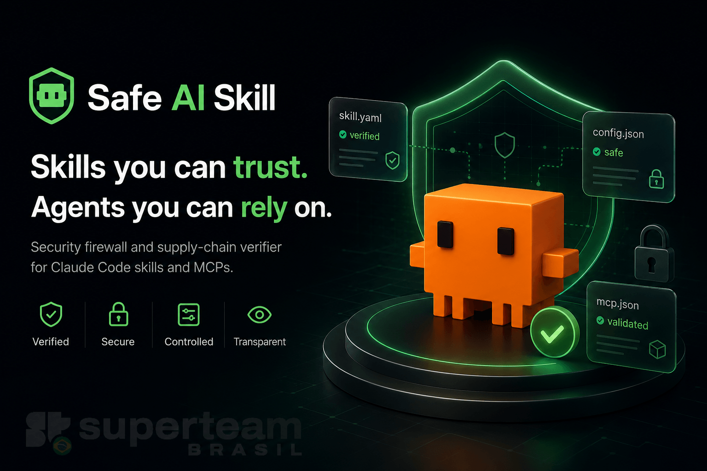

<p align="center">
  
</p>

<p align="center">
  <a href="https://github.com/solanabr/safe-ai-skill/actions/workflows/ci.yml"></a>
  
  
  
</p>

# safe-ai-skill

A hook-based security firewall and supply-chain verifier for Claude Code skills, MCPs and agents.

safe-ai-skill is a Claude Code plugin with a Rust engine. Before a tool call runs, it checks the call's text against a policy: destructive git commands, secret and credential reads, data leaving for known exfiltration hosts, download-and-run, tampering with its own settings, and, for Solana work, irreversible or value-moving on-chain actions. At session start it grades and pins the project's skill packs. It works with any skills, MCPs or agents. [solana-ai-kit](https://github.com/solanabr/ai-kit) is the reference integration for the Solana gates.

## Quick start

**Requires** Claude Code 2.1.295 or newer (older versions ignore the hooks' `onFailure` setting). On Windows, Claude Code must use Git Bash: `PowerShell` tool calls are not gated.

```bash
curl -fsSL https://raw.githubusercontent.com/solanabr/safe-ai-skill/main/install.sh | sh
```

This installs the `safe-ai-skill` CLI and, when `claude` is on your `PATH`, the Claude Code plugin that runs the hooks. Every Claude Code session is now protected, at the default `relaxed` tier, with no per-project setup. A clean session prints nothing at start, so to see it work, ask Claude to run `git reset --hard` in a throwaway repo: it is denied. Other ways to install, and what the script does, are under [Install](#install).

Then try:

```bash
safe-ai-skill status                    # tier, live grants, spend caps, recent decisions
safe-ai-skill doctor                    # check your Claude Code settings, print a denyRead snippet
safe-ai-skill tier medium               # raise the user-scope tier for every project (--project: this repo only)
safe-ai-skill firewall apply medium -n  # preview the sandbox block for a tier (-n: write nothing)
```

`firewall apply <tier>` writes a safe-ai-skill-owned block of sandbox restrictions into the project's `.claude/settings.local.json` (at High also a permission deny), and it also sets the plugin tier, for every project unless you pass `--project`. Drop `-n` to write it; it takes effect at the next session. See [Settings manager](#settings-manager-firewall).

### What a block looks like

Claude Code sends each hook a JSON payload, and the engine answers with a decision. For a Bash call running `git reset --hard HEAD~3`, `safe-ai-skill gate-bash-secrets` printed:

```json
{"hookSpecificOutput":{"hookEventName":"PreToolUse","permissionDecision":"deny","permissionDecisionReason":"safe-ai-skill git guard: this runs git reset --hard, discarding uncommitted changes, which is denied at every tier; if the user wants it, they run it themselves."}}
```

For `npx some-undeclared-pkg` in a project that doesn't declare the package, it printed an `ask`:

```json
{"hookSpecificOutput":{"hookEventName":"PreToolUse","permissionDecision":"ask","permissionDecisionReason":"`npx` downloads and runs `some-undeclared-pkg`, which this project's package.json or its lockfile does not declare — add it as a dependency, or approve if you trust the package."}}
```

Per Claude Code's hooks documentation, the reason of a `deny` is shown to the model, and the reason of an `ask` is shown to you in the permission prompt.

**On this page:** [Features](#features) · [Install](#install) · [Usage](#usage) · [Verify skills and MCPs](#verify-skills-and-mcps-before-you-install-them) · [Configuration](#configuration) · [Integrations](#integrations) · [Security model](#security-model-and-limitations) · [Upgrading](#upgrading-from-10x-to-130) · [Docs](#documentation) · [License](#license)

## Features

"Asks" means Claude Code shows you a permission prompt. Each link goes to the per-tier rules in [docs/tiers.md](docs/tiers.md#tripwire-gates-by-tier).

| Area | Guard | What happens |
|---|---|---|
| **On-chain (Solana)** | [Irreversible actions](docs/tiers.md#on-chain-unrecoverable-vs-counterparty): `program close`, `spl-token close-mint` and `burn`, `authorize --disable`, `anchor idl close`, `--final` | Denied on mainnet or an unknown cluster, asks on localnet, devnet or testnet. Nothing relaxes it |
| | Transfers, swaps, deploys and authority changes (`solana`, `spl-token`, `anchor`) | Asks (denied at High on mainnet), with spend caps and time-boxed grants for transfers, swaps and deploys |
| | [MCP tools that move value](docs/tiers.md#mcp-calls) (`transfer`, `swap`, `stake`, `mint`, …) | Asks on any connected MCP (denied at High) |
| **Secrets** | [Keys and credential stores](docs/tiers.md#key-material-and-home-credential-stores): `~/.ssh`, `~/.aws`, keychains, wallets, Solana keypairs, Claude Code transcripts | Read denied at every tier |
| | [Project `.env` files](docs/tiers.md#project-env-files) | Follow the tier (denied at High); `.env.production` is denied from Relaxed. `safe-ai-skill env` lets the agent work with keys, never values |
| | Tool output and prompts | Keys, seed phrases, PEM blocks and tokens are redacted from successful Bash, Read, Grep and MCP results. A prompt that pastes a private key or seed phrase is blocked |
| | [Environment dumps](docs/tiers.md#environment-dumps): `/proc/*/environ`, `echo $SECRET` | Denied; `printenv` runs with secret values blanked |
| | [Key files git would commit](docs/tiers.md#key-file-hygiene) | Listed at session start; `git add` of one asks (denied from Medium) |
| | [Exfiltration](docs/tiers.md#exfiltration-tripwire) | Request-bin, tunnel and paste hosts are denied from Relaxed; a key or env file sent by path is denied; an inline `curl` or `wget` POST to another host asks |
| **Repo and machine** | [Destructive git](docs/tiers.md#git-and-gh-guard): `reset --hard`, `clean`, `push --mirror`, `reflog expire` | Denied at every tier. Force push and `gh pr merge` ask from Medium (denied at High) |
| | [Download-and-run](docs/tiers.md#download-and-run): `curl \| sh`, a one-shot `npx` or `uvx` of an undeclared package | Asks (denied at High) |
| | [Encoded commands](docs/tiers.md#encoded-commands): `base64 -d \| sh`, hex `printf`, `$'…'` | Decoded and judged like the plain command; one that can't be decoded asks |
| | [Privileged containers](docs/tiers.md#container-privilege-guard) and host mounts | Asks (denied at High) |
| **The firewall itself** | [Tamper](docs/tiers.md#tamper-settings-hooks-and-config-content): settings that turn it off (`disableAllHooks`, `bypassPermissions`, …), shell startup files, managed settings | Denied. Git hooks, `.mcp.json` servers and `package.json` lifecycle scripts ask |
| | [Sandbox settings](docs/tiers.md#settings-manager) a plugin can't ship | `safe-ai-skill firewall apply` writes them |
| | [Session report](docs/tiers.md#session-report) | A summary at session end and a one-line recap at the next start |
| **Supply chain** | [Skill packs](docs/tiers.md#supply-chain) in `.claude/skills` | Graded and pinned at session start; a changed or risky pack is blocked in place |
| | [New skills, MCPs and repos](#verify-skills-and-mcps-before-you-install-them) | `safe-ai-skill add` checks one before you install it |

The hook table (event, subcommand, fail-open or fail-closed) is in [docs/cli.md](docs/cli.md#hooks).

## Install

Requires Claude Code 2.1.295 or newer. Older versions still run the hooks but ignore their `onFailure` setting, so a hook that can't start never blocks anything. The prebuilt engine covers macOS (arm64, x64), Linux (x64, arm64; static musl builds, so any distribution) and Windows (x64, also used on ARM). On Windows, Claude Code must use Git Bash: the shell gates cover the `Bash` tool only, `PowerShell` tool calls are not gated, and PowerShell-only setups fail open with a notice. SessionStart warns when the plugin is installed from more than one marketplace (only one copy's hooks run) and when it can tell Claude Code is older than 2.1.295.

The hooks run from the Claude Code plugin. The CLI (`tier`, `status`, `doctor`, `firewall`, `env`, `add`) is a separate binary. `install.sh` sets up both.

### install.sh: plugin and CLI (recommended)

```bash
curl -fsSL https://raw.githubusercontent.com/solanabr/safe-ai-skill/main/install.sh | sh
```

1. It downloads the prebuilt binary for your platform and checks its SHA-256 against the release's `SHA256SUMS`; on a mismatch it installs nothing. On macOS and Linux it also installs the shim as `safe-ai-skill`, with the binary beside it as `safe-ai-skill-<platform>`. The shim checks the binary's sha256 and is the entry point the [Codex hooks](docs/adapters.md) need.
2. When `claude` is on `PATH`, it installs the plugin with the same two commands as [Plugin only](#plugin-only). If a copy is already installed (for example `safe-ai-skill@stbr` from solana-ai-kit), it leaves that copy alone, because only one copy's hooks run.

`SAFE_AI_SKILL_BIN_DIR` sets the location (default `~/.local/bin`), `SAFE_AI_SKILL_VERSION` the release, and `SAFE_AI_SKILL_PLUGIN=0` skips the plugin. It runs on macOS, Linux and Git Bash on Windows.

### Plugin only

```bash
claude plugin marketplace add https://github.com/solanabr/safe-ai-skill.git
claude plugin install safe-ai-skill@safe-ai-skill
```

Dev install: `claude plugin marketplace add .` from the repo root, then the same `install` command.

No `settings.json` merge is needed: Claude Code merges plugin hooks with project hooks automatically, and a `deny` from these hooks survives `bypassPermissions` and `enableAllProjectMcpServers: true`.

**solana-ai-kit users: do nothing.** The kit's `stbr` marketplace already installs safe-ai-skill. With two copies installed, only one copy's hooks register and you can't tell which.

**Moving from `safe-ai-skill@stbr`.** The kit's marketplace is also named `stbr`, and removing it uninstalls the kit and deletes its data. Run `claude plugin marketplace list` first and read the steps in [docs/upgrading.md](docs/upgrading.md#moving-from-safe-ai-skillstbr) before you remove anything.

### CLI only: npm or cargo

These install the CLI without the hooks. For the hooks, also run `install.sh` or the [Plugin only](#plugin-only) commands.

```bash
npm install -g @stbr/safe-ai-skill    # command: safe-ai-skill (or npx @stbr/safe-ai-skill <command>)
```

`postinstall` downloads the binary for the package's release tag and aborts on a checksum mismatch. It installs the binary only, with no shim; use `install.sh` for Codex.

From 1.3.1, every release is also published to crates.io (before that it carried only 1.0.0). Name the release, so cargo doesn't pick another one, and build with its lockfile:

```bash
cargo install safe-ai-skill --version <version> --locked
```

This installs the binary only, with no shim; use `install.sh` for Codex. To build from a checkout of the release tag instead (CI builds with Rust 1.98.1; the project declares no minimum version):

```bash
git clone --branch v1.3.4 https://github.com/solanabr/safe-ai-skill && cd safe-ai-skill
cargo install --locked --path crates/engine
```

## Usage

### Firewall tiers

The tier is an input to the gates: `off < relaxed < medium < high`, default `relaxed`. `off` is not `SAFE_AI_SKILL_DISABLE=1`: every row that denies at Off still denies.

| Tier | What it does (not cumulative; see the notes) |
|---|---|
| `off` | Every row that denies at Off still denies: credential stores, key material, irreversible mainnet actions, default-wallet destruction, the tamper tripwire, the prompt guard, and redaction. Supply-chain problems are reported, not denied, and the exfil host list is empty |
| `relaxed` (default) | As Off, plus blocked, drifted and unscanned skill packs denied in place, the exfil host list, and `.env.production` reads denied. Value-moving mainnet actions ask |
| `medium` | As Relaxed, plus project `.env` writes denied, MCP tool-name denies, force push and `gh pr merge` asks, `gh api` denied, and `git add` of key files denied |
| `high` | As Medium, except that project `.env` writes are open again (the model can no longer read the file back). Project `.env` reads are denied; value-moving mainnet actions, MCP tools, force push and `gh pr merge` deny instead of ask; unreviewed-HIGH packs are denied; many other asks become denies; the engine never emits `allow` |

The full per-gate table is in [docs/tiers.md](docs/tiers.md#behaviour-per-gate), and the gates it does not list are in [Tripwire gates by tier](docs/tiers.md#tripwire-gates-by-tier). Only a user-scope tier, written by `safe-ai-skill tier` and confirmed by you, can go below the default. A tier named by solana-ai-kit's `.claude/security.json`, a repo's `.safe-ai-skill/policy.yaml` or `SAFE_AI_SKILL_TIER` can only raise it. Without Claude Code's sandbox declared on, the label reads `relaxed (hooks only)`.

### Everyday commands

`safe-ai-skill --help` lists the commands, and `safe-ai-skill help <command>` (or `<command> --help`) prints one command's usage without running it. Every subcommand and flag is in [docs/cli.md](docs/cli.md).

```bash
safe-ai-skill tier                       # show the tier, where it came from, the sandbox state
safe-ai-skill tier high [--project]      # off | relaxed | medium | high; --project scopes it to this repo
safe-ai-skill allow --scope transfer --for 30m --max-tx 1 --budget 5 [--to <addr>]   # time-boxed grant
safe-ai-skill revoke                     # drop every grant at once
safe-ai-skill status                     # tier, grants, pending requests, spend, recent decisions
safe-ai-skill doctor                     # settings check; --codex checks the Codex hooks
safe-ai-skill firewall apply|show|check  # settings manager
safe-ai-skill env keys|set|unset|init-schema   # work with .env files without printing values
```

Grant scopes are `transfer`, `swap` and `deploy`. `allow` refuses `authority` and `destructive`, because every authority or destructive verdict is a hard guard that no grant relaxes. A grant covers one action of its scope, and a command line chaining several gated actions is never covered.

**Spend caps.** The default policy asks above 1 SOL per transaction, denies above 10 SOL, and caps the day at 5 SOL; `status` prints them. Only a repo policy can lower them.

### Confirming a relaxation and headless runs

`allow`, a `tier` lowering and an `--env-read` loosening only record a request; Claude Code shows **you** a code that never enters the agent's context, and the change takes effect when your next prompt is exactly `safe-ai-skill confirm <code>`. Rules, including where confirmation is unavailable: [docs/cli.md](docs/cli.md#confirming-a-relaxation). In CI, or with a headless switch set, every `ask` becomes a `deny` and nothing can be confirmed. `claude -p` on its own does not turn headless on, though no confirmation code is shown or accepted there. Rule: [docs/tiers.md](docs/tiers.md#headless).

### Working with secrets

Raw reads of the project's `.env` and `.env.*` follow the tier, so at Off, Relaxed and Medium the model sees the values. `safe-ai-skill env keys|set|unset` lets the agent work with keys and never values, and `env init-schema` writes a committed `.env.schema` it can read instead. `safe-ai-skill tier --env-read deny` denies project `.env` reads at every tier. The three ways to handle secrets are in [docs/cli.md](docs/cli.md#environment-files); the rules are in [docs/tiers.md](docs/tiers.md#project-env-files).

### Settings manager (`firewall`)

`safe-ai-skill firewall apply|show|check` writes the sandbox block a plugin can't ship into `.claude/settings.local.json`, never writes `sandbox.enabled: false`, and leaves your own rules alone. Naming a tier also sets the plugin tier (see Quick start). Raising applies at once; lowering needs the confirmation code. Syntax and caveats (for example at High): [docs/cli.md](docs/cli.md#settings-manager) and [docs/tiers.md](docs/tiers.md#settings-manager). To force the plugin and the sandbox on for an organization, see [SECURITY.md](SECURITY.md#admin-lock-down).

## Verify skills and MCPs before you install them

```bash
safe-ai-skill add skill <owner/repo|url|dir>   # check a skill; prints the install command
safe-ai-skill add mcp <pkg|url|dir>            # check an MCP server: provenance and known CVEs
safe-ai-skill add repo <owner/repo|url|dir>    # same for a repository
safe-ai-skill install [--from <dir|tarball>] [--yes|--force]   # verified install from a local source
safe-ai-skill verify check <dir>         # grade one directory as the sweep would, every finding listed
safe-ai-skill verify                     # the session sweep: grade and pin installed packs
safe-ai-skill verify approve <name>      # re-pin a drifted pack after you reviewed it
safe-ai-skill registry list|verify       # the opt-in skill-registry.json catalog and its risk classes
```

`add` installs nothing and pins nothing: it checks the source and prints the install command (`npx skills add …`, `claude mcp add …` or `git clone …`) for you to run. A local directory, for every kind, is graded by the same rule engine as the SessionStart sweep. Remote content is not fetched or scanned. **Only a source you pinned yourself can pass:** a GitHub source naming a full commit (`owner/repo#<sha>`, or a `tree/<sha>` or `commit/<sha>` URL) or an npm package with an exact `x.y.z` version. **Everything else is held until you pass `--yes`:** a branch, tag or missing version (online, `add` first resolves it to the commit or version it names now, and the printed command installs exactly that), a source that isn't GitHub, npm or a local directory (a GitLab or tarball URL, a remote MCP server), and an osv.dev lookup that fails or comes back incomplete. An npm version, named or resolved, is checked on osv.dev for known advisories; a high-severity one, or a typosquatted npm name, blocks. A high-risk catalog entry (wallet signing, key custody, installer script) also needs `--yes`, however its package or repository is spelled. `install` never downloads and does no CVE lookup: fetch a hub yourself and pass `--from`. The command `add` prints for each kind of source, and its flags: [docs/cli.md](docs/cli.md#verify-add-and-install).

`install` and `verify approve` change what the firewall pins, and `add` is a user-only install step, so the agent can't run them; run them in your own terminal.

## Configuration

A repository can tighten the policy with `.safe-ai-skill/policy.yaml`. A setting that would loosen it is ignored and listed at SessionStart. The full schema, with defaults, is [`default.policy.yaml`](plugins/safe-ai-skill/policy/default.policy.yaml). Common keys:

```yaml
version: 1
tier: high                       # may only raise the tier
spend:
  per_tx_sol_max: 0.5            # caps take the lower value
secrets:
  env_read: deny                 # project .env reads denied at every tier
  exfil_hosts_extra: []          # extra hosts for the exfil tripwire (ignored at Off)
supply_chain:
  verify_skills_dirs: [ ".claude/skills", "~/.claude/skills" ]   # the only dir outside the project a repo may add
```

A project may also commit `.safe-ai-skill/packs.lock` to pin skill-pack contents for everyone.

Environment variables are listed in [docs/cli.md](docs/cli.md#environment-variables). `supply_chain.on_block: move` (quarantine instead of deny in place) is a user opt-in that a repo policy cannot set.

## Integrations

### solana-ai-kit

The kit's `stbr` marketplace installs this plugin. The kit pins a specific plugin commit (1.0.0, `2997280e`, as of kit 2.4.0), so a release here reaches kit users when the kit moves the pin. The two split the firewall by what each can enforce ([ai-kit#264](https://github.com/solanabr/ai-kit/issues/264), [ai-kit#265](https://github.com/solanabr/ai-kit/issues/265)):

- **The kit owns:** the OS sandbox, permission rules, tier selection and regeneration (`/firewall`, `.claude/security.json`), and its own hooks for git, publish, fetch-and-execute and `gh`.
- **This plugin owns:** the Solana gates (cluster, amounts, irreversible and authority actions, grants), secrets for plugin-only users, supply chain, the tier as an input, an exfil tripwire, and the tamper, git and `gh`, download-and-run, env-dump, encoded-command, container, key-file and MCP tool-name gates. It carries hook-level counterparts of the kit's git, `gh`, fetch-and-execute and MCP tool-name rules as defence in depth; the publish gate is not covered here. It reads the kit's `.claude/security.json` as a raise-only tier hint.
- **Shared:** versioned list files in [`policy/shared/`](docs/tiers.md#shared-lists) and a conformance corpus.

The kit's `/firewall` skill and this CLI's `safe-ai-skill firewall` are different things. Until the kit change lands, `/firewall` does not run `safe-ai-skill tier`; run `safe-ai-skill tier <t> --project` yourself. Both hook sets run on every Bash call.

### Codex CLI and opencode (experimental)

`safe-ai-skill adapt codex <entry>` runs the Bash, file-edit and MCP gates and a session-start report as Codex hooks, turning every `ask` into a `deny` because Codex hooks can't ask. A small plugin in [`adapters/opencode/`](adapters/opencode/) runs the Bash, Read/Grep, file-edit and MCP gates for opencode, without `WebFetch` or output redaction. Grants can only be confirmed in Claude Code. Both have known gaps; run `safe-ai-skill doctor --codex` after setup and every update, because Codex runs the call when a hook command can't start. Setup and limits: [docs/adapters.md](docs/adapters.md).

## Security model and limitations

safe-ai-skill protects against a careless model and prompt-injected instructions. Every gate decides from the text of a tool call, not from what the call does once it runs, so a determined or prompt-injected model can get past them. It is not a sandbox: code that runs unsandboxed as your user can rewrite the plugin's state, so the Claude Code sandbox is the hard boundary. State (grants, tier, spend ledger) is signed with a per-install key, which makes tampering evident, not impossible. Hard guards (authority changes, account closes, irreversible on-chain actions, key-material and credential-store reads) are not relaxed by any tier, grant, flag or repo policy.

**Recommended setup.** A Claude Code plugin can't ship `sandbox` or `permissions` settings, so the plugin can't close the holes below by itself. Run [solana-ai-kit](https://github.com/solanabr/ai-kit) alongside it, at Relaxed or above: its OS sandbox and permission rules close most of them. Without the kit, turn on Claude Code's own sandbox with the `denyRead` and `deniedDomains` entries in [SECURITY.md](SECURITY.md#recommended-setup); `safe-ai-skill doctor` checks your settings and prints a `denyRead` snippet.

### Known holes

In short; the full table, with what closes each, is in [SECURITY.md](SECURITY.md#known-holes).

- **Cross-call write-then-run:** a script written in one call and run in a later one.
- **Encoded and indirect forms:** `base64 -d`, `$'…'`, variables, runtime-built paths, `python3 -c` one-liners. The encoded-command gate decodes literal payloads; one it can't decode asks (deny at High). A shell fed what a command substitution prints, through a pipe, a here-string or a process substitution, asks the same way, unless the substitution only prints a literal, which is read.
- **Project `.env` values below High:** at Off, Relaxed and Medium the model can read `.env` and `.env.*`. A value it has seen can leave through channels the hooks can't fully gate (a `WebFetch` URL or MCP argument to a host the exfil list doesn't name, MCP servers, DNS). The control is the kit's sandbox `deniedDomains`, or Claude Code's sandbox; High, or `safe-ai-skill tier --env-read deny`, keeps the values out of the transcript. `.env.production` is denied from Relaxed, but not when reached through a glob, a differently named symlink or a directory Grep.
- **Bash writes to `.env` the hooks can't follow** (a script written earlier, encoded or runtime-built commands): only the sandbox's `denyWrite` closes them.
- **Any process running as you outside the sandbox:** test suites, `build.rs`, postinstall scripts, MCP server processes.
- **Values already in context:** a secret that was read has reached the model provider and the transcripts; nothing recalls it.
- **Failed tool calls are not redacted:** Claude Code gives the model their raw output and offers hooks no way to replace it.
- **Egress:** the exfil tripwire does not stop a host that isn't on its list (a fresh tunnel domain), an IP literal that carries no secret-shaped data, redirects, DNS, `WebSearch`, a secret without a recognisable shape, a remote configured in an earlier call, or a command built at runtime. The kit's sandbox `deniedDomains`, or Claude Code's sandbox, closes what the hook can't see.
- **Code run through an MCP executor** (for example context-mode's `ctx_execute`): shell code gets the Bash checks, but code in other languages gets only its string literals checked. Anything built at runtime gets through, as in Bash.
- **Directory search through Bash `grep`/`rg`:** only a pattern nudge applies.
- **Environment-dump and tamper limits:** a `/proc/<pid>/environ` path built at runtime, a secret printed by a tool other than `echo`/`printf`/`print`/`printenv`/`declare -p`, a write through an existing hard link, a base64-decoded write whose target never names a `.claude` path. A sandbox `denyWrite` on `.claude/settings*.json` is the control for tamper.
- **Engine crash or tampering by code running as you:** the confidentiality gates fail open (the on-chain, MCP and Skill gates block), and the state's HMAC makes tampering evident, not impossible.

The kit's sandbox and permission rules close most of these because they enforce file and network policy on every sandboxed process, not on command text. **Neither layer closes** values already in context, a `WebFetch` URL to a host neither list names [unverified for the kit's `deniedDomains`], DNS, MCP server processes, or commands the kit leads with `excludedCommands` (`anchor test*` and `surfpool *` run unsandboxed). Until the kit moves its plugin pin it still ships safe-ai-skill 1.0.0 ([ai-kit#264](https://github.com/solanabr/ai-kit/issues/264), [ai-kit#265](https://github.com/solanabr/ai-kit/issues/265)).

### When the engine can't run

If it has no binary for the platform, a wrong executable format or an exec failure (exit 126/127), the hooks fail open with a one-line notice, and SessionStart reports the firewall INACTIVE. That SessionStart message is the only place you see it, because Claude Code keeps an exit-0 hook's stderr in its debug log. `solana`, `spl-token` and `anchor` commands still ask. An engine crash is different: it blocks every Bash call, MCP call and Skill call until fixed. `SAFE_AI_SKILL_STRICT=1` turns the fail-open cases into blocks. `SAFE_AI_SKILL_DISABLE=1` switches the hooks off; it is ignored in strict mode, or when the project's committed `.claude/settings.json` mentions it or can't be read. Read [SECURITY.md](SECURITY.md) for the threat model and guarantees.

To report a vulnerability, follow [SECURITY.md](SECURITY.md#vulnerability-reporting).

## Upgrading from 1.0.x to 1.3.0

Upgrading from 1.3.3? Read [From 1.3.3 to 1.3.4](docs/upgrading.md#from-133-to-134): a shell running what a command substitution prints asks (deny at High), more of the ways a shell is handed its script are read, and rustup's installer one-liner runs. From 1.3.2? [From 1.3.2 to 1.3.3](docs/upgrading.md#from-132-to-133): the Solana dev loop asks less on test clusters, transaction signatures are no longer treated as keys, and shell code a command hands a shell is judged like the code typed directly. From 1.3.1? [From 1.3.1 to 1.3.2](docs/upgrading.md#from-131-to-132): the secrets gate now sees reads and uploads wrapped in a dynamic shell script, and deeply nested commands past the parser's depth limit ask (deny at High). From 1.3.0? [From 1.3.0 to 1.3.1](docs/upgrading.md#from-130-to-131): `add` holds in more cases and its usage errors exit 3, `allow` refuses the `authority` and `destructive` scopes, and more MCP wallet calls ask.

1.3.0 is the first release since 1.0.0; 1.0.1, 1.1.0 and 1.2.0 never shipped on their own. Migrations run at your first 1.3.0 session. What you will notice:

- Profiles became tiers (`strict`/`autopilot` become `relaxed`, `paranoid` becomes `high`); a 1.0 `off` is not migrated.
- Relaxations need a code only you see. Unexpired 1.0 grants become pending requests, and the 1.0 spend ledger counts as spent for that UTC day.
- Skill-pack drift is a BLOCK until you run `verify approve`. `gate-bash` runs for every Bash call and fails closed, so a crash blocks Bash. The agent can no longer read Claude Code transcripts or its own auto-memory.
- Project `.env` reads follow the tier. `.env.production` is denied from Relaxed. `tier --env-read deny` restores deny-everywhere.
- New denies at every tier: `git clean`, `reset --hard`, `checkout -- <path>`, `echo $SECRET`, writes to shell rc files, `~/.gitconfig` and cargo config.
- An undeclared `npx` or similar one-shot package asks. Testnet is treated like devnet. Headless and CI runs turn every `ask` into a `deny`.

The full checklist, the 1.1.0 and 1.2.0 notes and the `@stbr` migration are in [docs/upgrading.md](docs/upgrading.md).

## Documentation

| Page | Contents |
|---|---|
| [docs/tiers.md](docs/tiers.md) | Tier behaviour per gate, each guard in detail, settings manager, headless |
| [docs/cli.md](docs/cli.md) | Every command and flag, the hook table, environment variables |
| [docs/upgrading.md](docs/upgrading.md) | Upgrade notes and the `@stbr` migration |
| [docs/adapters.md](docs/adapters.md) | Codex and opencode adapters |
| [docs/scanner-coverage.md](docs/scanner-coverage.md) | What the pack scanner detects and its limits |
| [SECURITY.md](SECURITY.md) | Threat model, known holes, recommended setup, reporting |
| [CHANGELOG.md](CHANGELOG.md) | Release history |
| [docs/RELEASING.md](docs/RELEASING.md) | Release process |
| [crates/engine/ARCHITECTURE.md](crates/engine/ARCHITECTURE.md) | Engine internals |

## License

[MIT](LICENSE)
