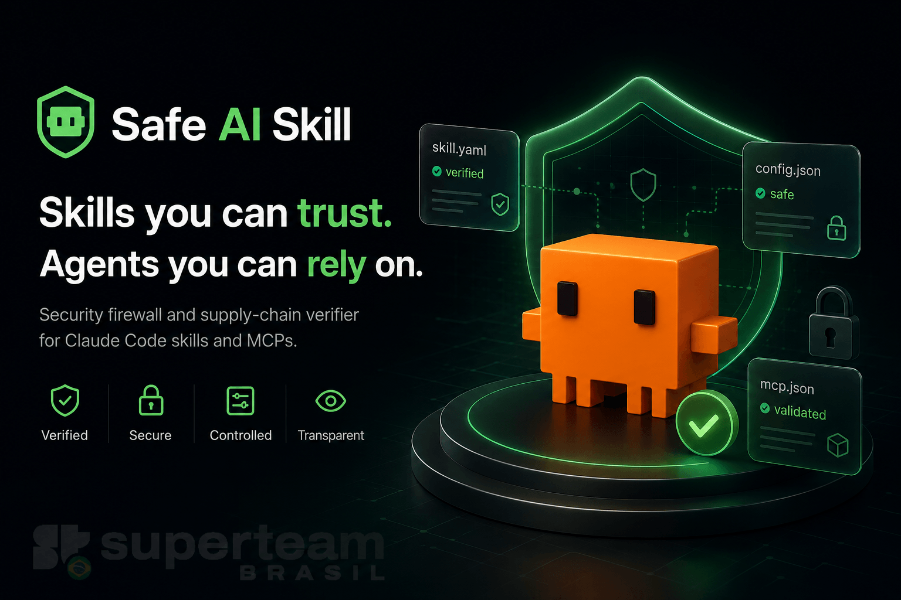

<p align="center">
  
</p>

<p align="center">
  <a href="https://github.com/solanabr/safe-ai-skill/actions/workflows/ci.yml"></a>
  
  
  
  
</p>

# safe-ai-skill

safe-ai-skill is a Claude Code security plugin — a Rust hook-based firewall and registry-free supply-chain verifier that works with **any skills, MCPs, or agents** to add a policy-driven security layer. It was built with `solanabr/solana-ai-kit` as the reference integration (gating Solana transactions and deploys, verifying its `ext/` submodules and `skill-registry.json` catalog), but the gates, guards, and verifier are general-purpose and protect any Claude Code setup.

At `PreToolUse` it intercepts commands, MCP calls, and secret-file reads before they execute. At `SessionStart` it walks every installed skill and MCP submodule, pins content to git SHAs, and reports anything that drifted. Hard guards — authority changes, account closes, irreversible on-chain actions, secret reads — are never relaxed by any tier, grant or flag. The one close that is not a hard guard is a program buffer close: a confirmed `destructive` grant can allow it below High.

## Read this first: what this plugin cannot protect on its own

> [!WARNING]
> **safe-ai-skill's firewall is hook-level string analysis, and it has known holes.** Every gate reads the text of a tool call and decides from that text. None of them watches what the call does once it runs, so a determined or prompt-injected model can get past them. Each adversarial review round of this engine found new bypasses, and we don't think that tail is exhausted. A Claude Code plugin can't ship `sandbox` or `permissions` settings (Claude Code drops both keys from a plugin), so the plugin can't close these holes itself.
>
> **The [solana-ai-kit](https://github.com/solanabr/ai-kit) implementation (OS sandbox plus permission rules) closes most of them. Run both.** Without the kit, turn on Claude Code's own sandbox with the recommended `denyRead` and `deniedDomains` entries in [SECURITY.md](SECURITY.md#recommended-setup).

Known holes, in short (the full table, with what closes each, is in [SECURITY.md](SECURITY.md#known-holes)):

- **Cross-call write-then-run:** a script written in one call and run in a later one.
- **Encoded and indirect forms:** `base64 -d`, `$'…'`, variables, runtime-built paths, `python3 -c` one-liners.
- **Bash writes to `.env`** (`sed -i`, `perl -pi`): not covered at any tier.
- **Any process running as you outside the sandbox:** test suites, `build.rs`, postinstall scripts, MCP server processes.
- **Values already in context:** a secret that was read has reached the model provider and the transcripts; nothing recalls it.
- **Egress:** no exfil tripwire ships in 1.1.0 (planned, [#19](https://github.com/solanabr/safe-ai-skill/issues/19)). Sending a secret file by path (`curl -d @.env`, `-T`, `-F`, `scp`) is denied and an inline `curl`/`wget` POST to a non-localhost host asks (below High, not when it goes to a known Solana RPC host), but requests to request-bin, tunnel and paste hosts, IP literals, redirects, DNS and `WebFetch` URLs are not gated. The kit's sandbox `deniedDomains`, or Claude Code's own sandbox with the entries in [SECURITY.md](SECURITY.md#recommended-setup), closes the host list.
- **Code run through an MCP executor** (for example context-mode's `ctx_execute`): shell code gets the same checks as a Bash call, but code in other languages gets only its string literals checked as paths and shell commands, and a Solana CLI named there asks. Anything built at runtime gets through, as in Bash.
- **Directory search through Bash `grep`/`rg`:** only a pattern nudge applies there.
- **Engine crash or tampering by code running as you:** the confidentiality gates fail open (the on-chain, MCP and Skill gates block), and the state's HMAC makes tampering evident, not impossible.

The kit's sandbox and permission rules close most of these because they enforce file and network policy on every sandboxed process, not on command text. Neither layer closes values already in context, `WebFetch` URLs [unverified], DNS, MCP server processes, or commands the kit leads with `excludedCommands` (`anchor test*` and `surfpool *` run unsandboxed).

**Recommended:** run safe-ai-skill together with solana-ai-kit's firewall at Relaxed or above, or enable Claude Code's own sandbox with the `denyRead` and `deniedDomains` entries in [SECURITY.md](SECURITY.md#recommended-setup). `safe-ai-skill doctor` checks your settings and prints a `denyRead` snippet. The scope split between the two projects is proposed in [ai-kit#264](https://github.com/solanabr/ai-kit/issues/264) and [ai-kit#265](https://github.com/solanabr/ai-kit/issues/265); until the kit moves its plugin pin, it still ships safe-ai-skill 1.0.0.

## Install

safe-ai-skill has two layers. The **plugin** is the always-on runtime firewall (SessionStart verifier + PreToolUse gates). The **CLI** is the `safe-ai-skill` binary that powers the Tier 1/2 commands (`registry`, `add skill`, `add mcp`, `install`, `verify`, `status`). Most users want the plugin; install the CLI too if you want to gate skill/MCP installs before they run.

### Plugin (runtime firewall)

Requires Claude Code 2.1.295 or newer. Older versions still run the hooks but ignore their `onFailure` setting, so a hook that can't start never blocks anything. The prebuilt engine covers macOS (arm64, x64), Linux (x64, arm64) and Windows (x64, also used on ARM). The Linux builds are static (musl), so they run on any distribution, Alpine included. On Windows, Claude Code must use Git Bash: the shell gates cover the `Bash` tool only, `PowerShell` tool calls are not gated, and PowerShell-only setups fail open with a notice. SessionStart warns when the plugin is installed from more than one marketplace (only one copy's hooks run) and when it can tell Claude Code is older than 2.1.295.

```bash
claude plugin marketplace add solanabr/safe-ai-skill
claude plugin install safe-ai-skill@safe-ai-skill
```

Every Claude Code session is protected automatically from that point. No per-project configuration required.

**Dev install:** `claude plugin marketplace add .` from the repo root, then `claude plugin install safe-ai-skill@safe-ai-skill`.

**solana-ai-kit users: do nothing.** The kit's `stbr` marketplace already installs safe-ai-skill for you. Don't add this marketplace as well: with two copies installed, only one copy's hooks register, and you can't tell which one.

#### Moving from `safe-ai-skill@stbr`

Between 1.0.0 and 1.0.1 this README said to install `safe-ai-skill@stbr`. The solana-ai-kit marketplace is also named `stbr`, and removing it uninstalls the kit and deletes its data. Check what your `stbr` is before you remove anything:

```bash
claude plugin marketplace list
```

- If `stbr` comes from anything other than `solanabr/safe-ai-skill` (for example `solanabr/solana-ai-kit`), stop. You have the kit's copy and there is nothing to move.
- If `stbr` comes from `solanabr/safe-ai-skill`, switch to the new name:

  ```bash
  # only if 'marketplace list' shows stbr → solanabr/safe-ai-skill
  claude plugin uninstall safe-ai-skill@stbr --keep-data
  claude plugin marketplace remove stbr
  claude plugin marketplace add solanabr/safe-ai-skill
  claude plugin install safe-ai-skill@safe-ai-skill
  ```

The plugin keeps its pins, grants and audit log in a directory named after `plugin@marketplace`, so the new install starts empty, and its first session pins whatever is on disk at that moment. To keep your existing pins, copy the old state across before you start a session:

```bash
mkdir -p ~/.claude/plugins/data/safe-ai-skill-safe-ai-skill
cp -R ~/.claude/plugins/data/safe-ai-skill-stbr/. ~/.claude/plugins/data/safe-ai-skill-safe-ai-skill/
```

### CLI (`safe-ai-skill` command)

The plugin runs the firewall; the Tier 1/2 commands need the `safe-ai-skill` binary on your `PATH`. Pick one:

**npm**

```bash
npm install -g @stbr/safe-ai-skill           # installs the CLI globally (command: safe-ai-skill)
npx @stbr/safe-ai-skill add skill <name|url>  # or run without installing
```

`safe-ai-skill add skill <name|url>` is the headline command — it runs the full verification pipeline on the fetched content before any install touches your machine (see [Usage tiers](#usage-tiers)).

**Standalone script** (no npm or cargo)

```bash
curl -fsSL https://raw.githubusercontent.com/solanabr/safe-ai-skill/main/install.sh | sh
```

Downloads the prebuilt binary for your platform and verifies its SHA-256 against the release's published `SHA256SUMS` before installing — checksum-pinned, not an opaque pipe. Set `SAFE_AI_SKILL_BIN_DIR` to override the install location (default `~/.local/bin`).

**cargo** (any platform with a Rust toolchain)

```bash
cargo install safe-ai-skill
```

The npm and standalone paths download the binary matching their release tag and abort on any checksum mismatch.

## What it protects

**Runtime (PreToolUse firewall)**

- CLI commands: any `solana`, `spl-token`, `anchor`, or arbitrary shell command matching policy
- MCP calls: value-moving and authority-changing verbs (`send*`, `stake*`, `delegate*`, `mint*`, `bridge*`, `lend*`, `borrow*`) across any connected MCP
- Secret reads: `.env` and other env files, keypair files (by name and by content), private keys, credential paths — on Read, Grep and MCP path arguments, matched case-insensitively and through symlinks (see [Secrets and `.env`](#secrets-and-env)). A [varlock](https://varlock.dev) `.env.schema` stays readable but is denied when it holds key material (a keypair, a private-key block, an API token, or a literal value on a secret-named key; `varlock(...)` calls, `$VAR` references and placeholders don't count), is over 64 KiB, or is not a regular `.env.schema` file. safe-ai-skill never runs `varlock`.
- Secret uploads: a `curl`/`wget`/`scp` that sends a key file or project env file by path is denied at every tier, and an inline `curl`/`wget` POST body to a non-localhost host asks, except a JSON-RPC body to a known Solana RPC host (the public `api.*.solana.com` endpoints, Helius, QuickNode, Alchemy's Solana hosts, Triton, Ankr, Syndica, extrnode; [docs/tiers.md](docs/tiers.md#exfiltration-tripwire-planned) has the list), which has no opinion below High. The host-list exfil tripwire (request-bin, tunnel and paste hosts) is planned ([#19](https://github.com/solanabr/safe-ai-skill/issues/19)) and does not ship in 1.1.0; use a sandbox `deniedDomains` list for that
- Interactive gate breakage: replaces broken `read -r` prompts (no TTY in hook context) with a functioning `ask` decision

**Supply-chain (SessionStart verifier)**

- Skill packs: sweeps the project's `.claude/skills`; `~/.claude/skills` only when a project's `.safe-ai-skill/policy.yaml` adds it to `supply_chain.verify_skills_dirs` (the only dir outside the project a project may add), plus packs installed there with `install --from`
- Pack state: each skill pack and `ext/` submodule is graded (clean, warned, unreviewed, blocked) and pinned by content (ext submodules also by git SHA). A combination rule, drift from the pin, or a mismatch with a committed `.safe-ai-skill/packs.lock` blocks the pack: it is denied in place (Skill tool, `/name`, reads and Bash access inside it) at Relaxed and above, and only reported at Off. A HIGH heuristic (unreviewed) is denied only at High. Nothing is moved unless `supply_chain.on_block: move`. `safe-ai-skill verify approve <name>` (or `verify trust <dir>`, which follows the content to other worktrees) clears drift, unreviewed and reviewed lock mismatches after you confirm it; nothing clears a combination rule.
- Catalog gating: classifies `skill-registry.json` entries by risk class (`wallet_signing`, `key_custody`, `installer_script`, `standard`); blocks installation of denied classes
- `curl | bash` detection: flags installer-script patterns before they execute
- MCP version tracking: flags `@latest` entries as informational — does not silently rewrite them
- CVE lookup: `add` queries osv.dev for an exact, non-local npm source such as `add mcp`'s resolved `pkg@version` (no API key required). The session sweep makes no network calls
- Pack scanner: rule-based detectors with code/doc/meta context (docs cap at WARN, a single code signal is HIGH, only combinations BLOCK); see [docs/scanner-coverage.md](docs/scanner-coverage.md)

**Hard guards (never relaxable)**

`set_authority` · `account_close` · irreversible on-chain actions · `secret_read`

No tier, grant, flag or repo policy relaxes them. Authority changes and account closes ask you (they deny at High on mainnet or an unidentified cluster), and secret reads are denied. Irreversible actions (`--final`, `program close` (program or buffer), `spl-token close-mint`/`close`/`burn`, `authorize --disable`, IDL erase/close, …) deny on mainnet or any cluster not positively identified as localnet or devnet, ask on an identified localnet or devnet, and no grant, tier, repo setting or env var changes either answer. A non-final deploy, including one to mainnet, is a counterparty action: it asks on mainnet or an unidentified cluster (deny at High), and a confirmed `deploy` grant can allow it below High.

## Firewall tiers

The plugin takes a tier as an input: `off < relaxed < medium < high`, default `relaxed`. (The `strict`, `paranoid` and `autopilot` profiles of 1.0 map onto these; see [Upgrading to 1.1.0](#upgrading-to-110-read-before-upgrading).) **`off` is not `SAFE_AI_SKILL_DISABLE=1`:** every `deny` row below holds at Off, and nothing but a user-scope tier can lower the tier. The table is the behaviour of each gate at each tier; `n/o` means no opinion (empty stdout, the call goes on to Claude Code's own permission flow).

| Gate | Off | Relaxed | Medium | High |
|---|---|---|---|---|
| Credential stores and key files, read by path or by command | deny | deny | deny | deny |
| Key material sent to a network command | deny | deny | deny | deny |
| Project env file, raw read (default `env_read: deny`) | deny | deny | deny | deny |
| … user-scope `env_read: tier`, sandbox `On` (opt-in; not in 1.1.0 release builds) | n/o | n/o | deny | deny |
| … user-scope `env_read: ask`, sandbox `On` (opt-in; not in 1.1.0 release builds) | ask | ask | ask | deny |
| varlock commands that print values | = raw read | = raw read | = raw read | = raw read |
| `.env.schema` and templates (content guard applies) | n/o | n/o | n/o | n/o |
| Write/Edit/MultiEdit to a project env file; agent `env set\|unset` | n/o | n/o | deny | deny |
| `env keys` | n/o | n/o | n/o | n/o |
| Pattern redaction (keys, seeds, PEM, vendor tokens) | on | on | on | on |
| Value scrub of project env values in tool output, except an opted-in raw read | on | on | on | on |
| Irreversible on-chain action (`--final`, `program close` (program or buffer), `spl-token close-mint`/`close`/`burn`, `authorize --disable`, …) on mainnet, an unknown cluster or testnet | deny | deny | deny | deny |
| … on a positively identified localnet or devnet (never relaxed by a grant) | ask | ask | ask | ask |
| Default-wallet destruction (keygen `--force`, file overwrite/delete) | deny | deny | deny | deny |
| Value-moving or authority-changing action on mainnet or an unknown cluster | ask | ask | ask | deny |
| … with a live confirmed grant covering it (grantable scopes only) | allow | allow | allow | deny |
| … on an identified test cluster: deploy/upgrade | n/o | n/o | n/o | n/o |
| … transfer within spend caps | allow | allow | allow | n/o |
| … authority change | ask | ask | ask | ask |
| Solana command the parser cannot read (opaque or dynamic) | ask | ask | ask | deny |
| MCP value-moving or signing tool (`gate-mcp`) | ask | ask | ask | deny |
| Project env file as a network command's input (a raw read) | deny | deny | deny | deny |
| Inline `curl`/`wget` POST body (no file upload) to a known Solana RPC host | n/o | n/o | n/o | ask |
| Inline `curl`/`wget` POST body to any other non-localhost host, or a file-body upload (`-d @file`, `-T`, `-F k=@file`) | ask | ask | ask | ask |
| Supply chain: combination rule, drift, lock mismatch, unscanned pack | report | deny in place | deny in place | deny in place |
| Supply chain: HIGH heuristic (unreviewed pack) | report | report | report | deny in place |
| Tamper tripwire, authenticated state, prompt guard | on | on | on | on |

What each row covers is explained in [docs/tiers.md](docs/tiers.md#behaviour-per-gate). At High the engine never emits `allow` (a grant or a within-cap transfer falls back to Claude Code's own flow), no tier emits `defer`, and headless runs turn every `ask` into a `deny`. A command line chaining two or more gated on-chain actions, or holding any hard-guard ask, is never covered by a grant, and a Bash command over 256 KiB (or with more than 2048 nested expansions) asks without being parsed (deny at High and headless). The raw env-read opt-in rows describe a build with the `env-read-opt-in` feature; 1.1.0 release builds ship without it, so raw reads stay denied at every tier whatever `env_read` says. The host-list exfil tripwire is planned ([#19](https://github.com/solanabr/safe-ai-skill/issues/19)) and has no row.

Choose a tier with `safe-ai-skill tier` ([Usage tiers](#tier-1--gate-installs-before-they-run) lists the command). Only a user-scope tier, written by that command and confirmed by you in the prompt, can go below the default. A tier named by solana-ai-kit's `.claude/security.json`, by a repo's `.safe-ai-skill/policy.yaml` or by `SAFE_AI_SKILL_TIER` can only raise it. Without Claude Code's sandbox declared on, the label reads `relaxed (hooks only)`. A clean session at the default tier prints nothing at SessionStart; the tier line appears when the tier isn't the plain default or there is anything else to report, and `safe-ai-skill tier` and `status` always print it. Selection, the confirmation flow, migration from profiles and the headless rule are in [docs/tiers.md](docs/tiers.md).

## Secrets and `.env`

Raw reads of env files (`.env`, `.env.*`, `*.env`, `.envrc`, `.dev.vars`, `~/.config/solana/cli/config.yml`) are denied at every tier, and the deny message gives the commands to use instead. Key material and home credential stores are denied at every tier, Off included, through Read, Grep, MCP path arguments and any Bash command that names them (metadata-only commands such as `ls` excepted): Solana keypairs and the Solana config tree (except `cli/config.yml`), `~/.ssh/**` (except `config`, `known_hosts` and `*.pub`), `~/.gnupg`, `~/.aws`, `~/.kube/config`, the `~/.claude/.credentials.json` token file, registry and git-host tokens (`~/.netrc`, `~/.git-credentials`, `~/.npmrc`, `gh/hosts.yml`, …), cloud and infrastructure CLI tokens (`~/.config/gcloud`, `~/.azure`, `~/.config/doctl`, `~/.terraform.d/credentials.tfrc.json`, `~/.config/helm`, `~/.vault-token`), keychains and password-manager stores, browser profiles and wallet-extension data. Naming an SSH key as the identity of `ssh`, `scp` or `sftp` (`-i <key>`, `-o IdentityFile=<key>`) or to `ssh-keygen -y -f` is allowed, since the key is used and not printed; any other use of a private key path is denied. Commands that print a credential (`gh auth token`, `git credential fill`, `security find-generic-password -w`, `aws configure get *secret*`, `npm config get *_authToken`, `docker-credential-* get`, `pass show`, `op read`, `bw get`, …) are denied the same way. `.env.example|.sample|.template|.dist` and `.env.schema` stay readable. A Grep over a directory gets env, key and credential globs excluded from its results, including one rooted at or above `$HOME` (this also hides `.env.example` and `.env.schema` from directory searches; read them directly), and a Grep rooted inside a credential store is denied; Glob only lists names and is not gated. Tool output that still contains a value from a project env file, and any key, seed, PEM or vendor-token pattern, is shown redacted (`«redacted:KEY»`) at every tier. Reads of Claude Code transcripts (`~/.claude/projects/**`) are denied, which also stops the agent reading its own auto-memory files with its tools; open those yourself.

Three options, pick the one that fits; each keeps working without the next:

1. **Plain `.env` + `safe-ai-skill env`.** The agent works with keys, never values:

   ```bash
   safe-ai-skill env keys .env                              # keys with masked values
   printf %s '<value>' | safe-ai-skill env set .env KEY     # value on stdin, never in argv
   safe-ai-skill env unset .env KEY
   ```

2. **Add a `.env.schema`** ([env-spec](https://varlock.dev/env-spec/), the format varlock uses). It lists keys, types and `@sensitive`/`@required` decorators and is committed, so the agent can read it directly. `safe-ai-skill env init-schema` writes one from your `.env` (keys only, every key sensitive by default), and `env keys` then annotates each key and lists declared keys that are unset. safe-ai-skill parses the schema itself: it never runs varlock, because loading a schema with varlock executes `$(…)`/`exec()` values and plugins.
3. **varlock** with a secret provider or `varlock("local:…")` encryption. Run tools with `varlock run -- <cmd>` and inspect with `varlock load --agent`. Commands that print resolved values (`varlock printenv`, `reveal`, `load --format json|env|shell` without `--agent`, …) are treated like `cat .env`.

Writes follow the tier: Write, Edit and MultiEdit to a project env file, and an agent-run `env set|unset`, are allowed at Off and Relaxed and denied at Medium and High. A write through Bash (`sed -i`, `perl -pi`, `python3 -c`) is not covered at any tier.

**The raw read opt-in ships disabled in 1.1.0.** `safe-ai-skill tier --env-read ask|tier` is accepted and stored, but release builds print that it is inactive and keep denying raw reads; SessionStart says the stored setting is inactive. It stays off until the planned exfil tripwire ([#19](https://github.com/solanabr/safe-ai-skill/issues/19)) can deny a project env file sent to the network. In a build with the `env-read-opt-in` cargo feature, `ask` prompts on every read below High and `tier` leaves reads alone at Off and Relaxed and denies them at Medium and High; the setting is user-scope only (loosening needs your confirmation in the prompt, and a repo policy, a kit file or an env var can only tighten it), it works only while Claude Code's sandbox is declared on (`sandbox.enabled` in your settings, on macOS or Linux with `bwrap`), and the response to an opted-in raw read isn't value-scrubbed, so an Edit of one line leaves the other values intact.

The hooks stop a careless or prompt-injected model; for a hard boundary enable Claude Code's sandbox with `sandbox.filesystem.denyRead` — `safe-ai-skill doctor` checks your settings and prints the globs to add.

## Threat model

safe-ai-skill protects against a careless model and prompt-injected instructions. It is not a sandbox. Code that runs unsandboxed as your user can rewrite any user-space state, including the plugin's grants, pins and settings, so the Claude Code sandbox is the hard boundary. A tamper tripwire denies agent tool calls that would loosen the firewall from the inside, but encoded commands, variable indirection and scripts written now and run later can get past it. [What this plugin cannot protect on its own](#read-this-first-what-this-plugin-cannot-protect-on-its-own) lists the known holes. Run `allow`, `tier <lower>` and `verify approve` yourself in a terminal.

If the engine can't run on a platform (no prebuilt binary, wrong executable format, exit 126/127), the hooks fail open with a one-line notice and SessionStart reports the firewall INACTIVE, but `solana`, `spl-token` and `anchor` commands still get `ask`. `SAFE_AI_SKILL_STRICT=1` blocks instead. `SAFE_AI_SKILL_DISABLE=1` switches the hooks off, and is ignored (the hooks keep running) in strict mode, or when the project's committed `.claude/settings.json` mentions it or can't be read. See [SECURITY.md](SECURITY.md) for details.

## Upgrading to 1.1.0 (read before upgrading)

- **Relaxations need a code only you see.** Unexpired 1.0 grants become pending requests at your first 1.1.0 session; confirm each as described under [Usage tiers](#tier-1--gate-installs-before-they-run), or re-create it. The 1.0 spend ledger counts as spent for the rest of that UTC day. Lowering the tier needs the same confirmation, and nothing can be confirmed in headless `claude -p`.
- **Profiles became tiers.** `strict` (the 1.0 default) becomes `relaxed`, `paranoid` becomes `high`, and `autopilot` becomes `relaxed` (the notice names `safe-ai-skill allow --scope transfer` for what autopilot's higher cap did). A tier below `relaxed` is never migrated: a 1.0 `off` is set aside with a hint to run `safe-ai-skill tier off` (confirmed) or set `SAFE_AI_SKILL_DISABLE=1`. Your first session prints one line about it. Raw `.env` reads stay denied for everyone after the upgrade.
- **What `relaxed` now denies.** Irreversible actions (`--final`, `program close` (program or buffer), `spl-token close-mint|close|burn`, `authorize --disable`, IDL erase/close, `close-vote-account`) now deny on mainnet, testnet and any cluster that isn't positively identified as localnet or devnet (an RPC host without an `http(s)://` scheme identifies nothing), and still ask on an identified localnet or devnet. Credential stores beyond `~/.ssh/id_*` (`~/.aws`, `~/.gnupg`, `~/.netrc`, `~/.npmrc`, cloud CLI tokens, keychains, browser and wallet-extension data, and more) are read-denied at every tier, by path and by any Bash command naming them. An inline `curl`/`wget` POST body to a non-localhost host still asks at every tier (a deny under `claude -p`), except an inline body to a known Solana RPC host, which has no opinion below High.
- **`gate-bash` runs for every Bash call and fails closed.** It used to run only for commands starting with `solana`, `spl-token` or `anchor`, so wrapped forms (`env FOO=1 …`, `bash -c '…'`, `timeout 5 …`) and `solana-keygen` never reached it. A fast path keeps ordinary commands cheap. If the engine crashes, Bash calls are blocked until it is fixed; if it cannot run on your platform at all, only commands naming the Solana CLIs ask.
- **Headless asks become denies.** Under `claude -p` or CI (`CI`, `GITHUB_ACTIONS`, no `/dev/tty`, …), every `ask` is a `deny`; only a grant you confirmed interactively beforehand passes. `CONFIRM_MAINNET`-style env variables are ignored, and no setting turns headless off.
- **Skill-pack drift is a BLOCK.** A pinned pack whose content changes is denied (the Skill tool, `/name`, reads and Bash access inside it) until you run `safe-ai-skill verify approve <name>` in a terminal and confirm it. A pack the SessionStart sweep could not fully scan in its time budget is denied the same way until a later sweep scans it; `safe-ai-skill verify check <dir>` scans it without a budget.
- **The agent can't read Claude Code transcripts (`~/.claude/projects`) or the plugin's state key**, through Read, Grep or Bash. `safe-ai-skill doctor` recommends matching sandbox `denyRead` entries.
- **The Skill hook fails closed**: a broken engine blocks the Skill tool until it is fixed.
- **The CLI needs the plugin installed**: from a terminal it uses `$CLAUDE_PLUGIN_DATA`, else the plugin's data dir, and exits 1 asking for `CLAUDE_PLUGIN_DATA` when there is none.

**Runtime threats** — agentic workflows drive CLI commands and value-moving MCP calls with no gating. Interactive `read -r` prompts silently fail in hook context (no TTY). safe-ai-skill intercepts every such action before execution.

**Supply-chain threats** — skill hubs ship external submodules from third-party sources. Each submodule is its own supply-chain unit and can contain telemetry preambles, `curl | bash` installer scripts, or unpinned MCP packages. Opt-in skill catalogs include high-risk entry classes that can execute privileged code. safe-ai-skill catches all of this at session start, before any skill or MCP is active.

## Usage tiers

These are levels of use (install and go, gate installs, verified hub install), not the [firewall tiers](#firewall-tiers).

### Tier 0 — install and go

Install once. Every session is protected automatically. No configuration required.

### Tier 1 — gate installs before they run

```bash
safe-ai-skill registry list          # list catalog entries with risk classification
safe-ai-skill registry verify        # audit installed entries against registry
safe-ai-skill add skill <name|url>   # catalog entry or any GitHub URL, verified before install
safe-ai-skill add mcp <id|pkg|url>   # any MCP; verified before writing .mcp.json
safe-ai-skill verify                 # on-demand audit of all installed skills and MCPs
safe-ai-skill verify check <dir>     # grade one skill directory as the sweep would at your tier, listing every finding
safe-ai-skill verify approve <name>  # re-pin a drifted pack after you reviewed it
safe-ai-skill status                 # pins, tier, live grants, spend, recent decisions
safe-ai-skill tier                   # show the tier, where it came from, and the sandbox state
safe-ai-skill tier <name> [--project] [--env-read deny|ask|tier]
                                     # off | relaxed (default) | medium | high; lowering needs confirmation
safe-ai-skill tier --clear [--project]
safe-ai-skill allow --scope transfer --for 30m --max-tx 1 --budget 5 [--to <addr>]
                                     # request a time-boxed grant (needs confirmation)
safe-ai-skill revoke                 # drop every grant at once
safe-ai-skill session                # show active session state
```

`verify approve`, `install` and `add` change what the firewall pins, so the agent can't run them: the tamper tripwire denies them, and bare `verify` / `verify session` too, which only the SessionStart hook runs. Run them in your own terminal; `verify check <dir>` stays open to the agent because it pins nothing. From a terminal the CLI uses the same state as the hooks: `$CLAUDE_PLUGIN_DATA` if set, otherwise the plugin's dir under `~/.claude/plugins/data/` (or `$CLAUDE_CONFIG_DIR/plugins/data/`, which replaces `~/.claude`), `safe-ai-skill-safe-ai-skill` first, then `safe-ai-skill-stbr`, then the only `safe-ai-skill-*` dir. If none of these resolves it exits 1 and asks you to set `CLAUDE_PLUGIN_DATA`. `status` prints the dir it used.

**Relaxations need your confirmation in the prompt.** `allow` and a `tier` lowering (or an `--env-read` loosening) change
nothing on their own (the agent may run them, because they only create a request it cannot confirm): they record a request (`request r3fa91c`) and print no code. Claude Code
then shows **you** a confirmation code in a hook message (right after the command, or at your
next prompt or session start) that is never put in the agent's context. The request takes
effect only when your next prompt is exactly `safe-ai-skill confirm <code>`, on its own
(within 10 minutes, once); Claude Code then shows what you approved. A confirm line inside
pasted text is refused, and three wrong codes cancel every pending request. In headless `claude -p`, where
hook messages aren't shown, nothing can be confirmed. Raising the tier (or tightening `--env-read`) and `revoke` apply at
once. Grant scopes are `transfer`, `swap`, `deploy`, `authority` and `destructive`; anything
else is an error.

**Tiers.** `relaxed` is the default; see [Firewall tiers](#firewall-tiers) for what each tier
does. `safe-ai-skill tier` writes the user-scope tier (`--project` scopes it to the current
repository). Raising it applies at once; lowering it, or loosening `--env-read`, waits for your
confirmation. `SAFE_AI_SKILL_TIER` (alias `SAFE_AI_SKILL_PROFILE`), a repo's
`.safe-ai-skill/policy.yaml` `tier` and solana-ai-kit's `.claude/security.json` can only
raise the tier, so a repo or an env block can't loosen your firewall. `mode` is a deprecated
alias for `tier`. The tier `off` keeps every `deny` row; to turn the hooks off entirely, set
`SAFE_AI_SKILL_DISABLE=1`.

**State is authenticated.** Grants, the tier, the daily spend ledger and session metadata are
signed with a per-install key in the plugin data directory, and each file carries a
generation, so a hand-edited file or an older copy put back is ignored, a deleted or edited
spend ledger counts as today's budget spent, and a deleted, hand-edited or replayed
`tier.json` (or one whose key is gone) makes the tier High, with a SessionStart and `status`
note naming the cause, until you run `safe-ai-skill tier …` again. This is tamper-evident, not tamper-proof: code
running as you outside the Claude Code sandbox can read the key, run the hook commands itself
or restore a snapshot of the whole directory. The sandbox is the hard boundary. At the first
1.1.0 session, unexpired 1.0 grants become pending requests you can
confirm with the codes shown then; the 1.0 spend ledger becomes today's exhausted budget. A session
start with anything to report prints `tier: <t> (<source>); sandbox: <state>` and lists what is
currently loosened: a tier below the default, live grants, ignored repo policy and ignored tier
hints, state that failed authentication, and a Claude Code sandbox that is off. A clean session at
the default tier prints nothing.

Each `add` command runs the intrinsic verification pipeline on the actual fetched content before executing the underlying install. `registry list` shows the full catalog with risk classes flagged. High-risk entries (`wallet_signing`, `key_custody`, `installer_script`) require explicit approval.

### Tier 2 — verified hub install

```bash
safe-ai-skill install                        # verify the project's .claude/skills in place (scan, pin, no copy)
safe-ai-skill install --from <dir|tarball>   # verified install from a local skill directory or tarball
safe-ai-skill install --home ~               # install into <dir>/.claude/skills (default: ~)
```

`install` never downloads anything: `--from` takes a local directory or tarball, so fetch a hub yourself (for example `git clone`) and point `--from` at it. It runs the verification pipeline on every skill, neutralizes telemetry preambles, pins each pack, and holds a skill with a High finding, always. A skill with only Medium findings is held unless you pass `--yes`. With no `--from` it verifies the current project's `.claude/skills` in place, and rewrites a `SKILL.md` there to remove a telemetry preamble it finds. It does not auto-widen `~/.claude/settings.json` permissions.

## Registry-free verification model

Trust is based on the artifact itself, not a hash allowlist to maintain:

1. **Rule-based scan** — every file of a pack is classified as code, documentation or pack metadata, and detectors run in that context (strings and comments are data, interpolations are code). Findings in docs cap at WARN, a single code signal is HIGH (the pack is *unreviewed*: reported, not blocked), and only combinations of signals (an exfiltrating `` !`cmd` ``, padding plus a sink, `eval` plus a decoder, a symlink leaving the pack, …) BLOCK.
2. **Per-pack pinning** — each skill pack and `ext/` submodule is pinned on first sight by content (ext submodules also by commit SHA). Later drift blocks the pack, in place, until you approve it with `safe-ai-skill verify approve <name>` and confirm the code safe-ai-skill shows you.
3. **Catalog gating** — entries are classified by risk class. High-risk classes require explicit policy approval; safe-ai-skill blocks installation of denied classes without prompting.
4. **Provenance pinning** — GitHub URLs resolve to immutable commit SHAs (moving refs are rejected). npm packages pin to `pkg@x.y.z` plus `dist.shasum`. `@latest` entries are flagged informational.
5. **CVE lookup** — `add` queries osv.dev for an exact, non-local npm source (for example `add mcp`'s resolved `pkg@version`). No API key required. This is the only network step; the session sweep and gates make no network calls.
6. **Local state** — per-pack state (`state.json`, authenticated) records the pin, grade and findings; a project may commit `.safe-ai-skill/packs.lock` to pin pack contents for everyone (a mismatch blocks, a match can't clear a block).

At SessionStart: block on a combination rule or drift, report a HIGH as unreviewed, warn on documentation findings, pin clean. `add` and `install` also block on a known CVE.

## Integration model

Install any skill hub (e.g. `solanabr/solana-ai-kit`) alongside safe-ai-skill as a plugin. No `settings.json` merge is needed — Claude Code merges plugin hooks with project hooks automatically. safe-ai-skill's `deny` decisions survive `enableAllProjectMcpServers: true` and `bypassPermissions`.

### Using with solana-ai-kit

The kit's `stbr` marketplace installs this plugin; don't add this marketplace too (only one copy's hooks register). The kit pins a specific plugin commit (1.0.0, `2997280e`, as of kit 2.4.0), so a release here reaches kit users when the kit moves the pin.

- **The kit owns:** the OS sandbox, permission rules, tier selection and regeneration (`/firewall`, `.claude/security.json`), and the git, publish, fetch-and-execute, `gh` and MCP tool-name gates.
- **This plugin owns:** the Solana-semantic gates (cluster, amounts, irreversible and authority actions, mainnet, grants), secrets for plugin-only users (key material and home stores, `.env` through the `env` CLI, varlock and redaction) and supply chain (scan, pins, Skill and slash deny, no moves). A best-effort exfil tripwire is planned ([#19](https://github.com/solanabr/safe-ai-skill/issues/19)); until then the kit's sandbox `deniedDomains` covers known exfil hosts. It takes the kit's tier as an input: `.claude/security.json` can raise the plugin's tier, never lower it.
- **Shared:** versioned list files in [`policy/shared/`](docs/tiers.md#shared-lists) (credential globs, exfil hosts, on-chain verbs), which the kit vendors and pins, and a conformance corpus both parsers run.
- Duplicated hard denies are kept as defence in depth (default-wallet `solana-keygen --force`, irreversible actions on mainnet); two denies never conflict.

The proposal is in [ai-kit#264](https://github.com/solanabr/ai-kit/issues/264) (firewall scope) and [ai-kit#265](https://github.com/solanabr/ai-kit/issues/265) (docs); the proposed kit-side changes are drafted in [docs/drafts/aikit-firewall-split.md](docs/drafts/aikit-firewall-split.md). Until the kit change lands, `/firewall` does not run `safe-ai-skill tier`; run `safe-ai-skill tier <t> --project` yourself. Today both hook sets run on every Bash call.

safe-ai-skill is standalone — it can be installed independently of any particular skill hub. It adds a security and control layer over whatever skills, MCPs, and agents you already have.

## Security

See [SECURITY.md](SECURITY.md) for the full threat model, guarantees, out-of-scope items, and vulnerability reporting.

## License

MIT
